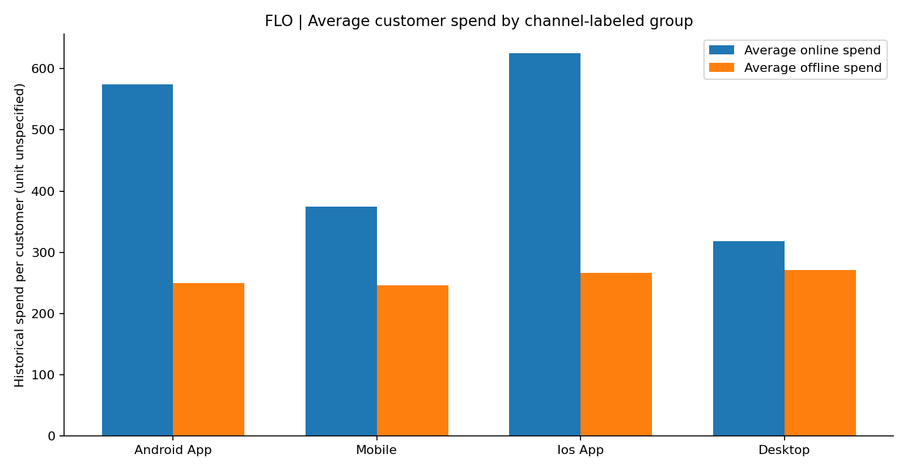

# FLO Customer Analytics | SQL & Omnichannel Insights

**SQL Server · T-SQL · Customer Analytics · Business Intelligence**

> An independent portfolio case study examining **19,945 FLO customer records** to understand customer-group distribution and historical online/offline spending patterns.

## Executive summary

**Business question:** How do customer groups differ in size, cumulative spend, and average customer value across online and offline shopping?

**What I did:** Used Microsoft SQL Server to validate customer counts, aggregate spending metrics, compare channel-labeled customer groups, and translate results into business-oriented observations.

**Key distinction:** `order_channel` is a customer-group label in this dataset. Online/offline spending fields represent historical spending by customers in each group; these figures **do not establish revenue transacted through each named app or device**.

## KPI snapshot

| Metric | Result |
|---|---:|
| Customer records / unique customers | 19,945 |
| Largest customer group | Android App (9,495; 47.6%) |
| Highest total offline spend | Android App (2,370,162.21) |
| Highest average online spend per customer | Ios App (625.59) |
| Highest average offline spend per customer | Desktop (270.88) |

*Spending units are not confirmed, so no currency symbol is assigned.*



## Business insights

1. **Scale and customer value are different metrics.** Android App is the largest customer group and has the highest aggregate offline spending; this should not be confused with having the highest average spend.
2. **iOS-labeled customers lead on average online spending** (625.59 vs. 573.87 for Android App), suggesting a potentially valuable segment for further analysis.
3. **Desktop-labeled customers have the highest average offline spending** (270.88), despite having the smallest customer count.
4. **Next investigation:** Compare recency, frequency, and monetary value across groups before recommending campaign targeting. These additional analyses are not included in this version.

These are **descriptive findings, not causal claims**. Group differences alone do not establish the effect of a channel or campaign.

## Repository contents

```text
flo-sql-customer-analytics/
├── README.md
├── sql/
│   └── customer_analysis.sql
├── results/
│   └── channel_summary.csv
├── visuals/
│   └── average_spend_by_channel.png
└── .gitignore
```

## SQL skills demonstrated

`SELECT` · `COUNT` · `COUNT(DISTINCT)` · `SUM` · `AVG` · `ROUND` · `GROUP BY` · `ORDER BY` · `WHERE` · `HAVING`

See [`sql/customer_analysis.sql`](sql/customer_analysis.sql) for the documented queries. The `HAVING` query is provided as a reproducible example; its output was not independently verified in this case study.

## Methodology and reproducibility

- Environment: Microsoft SQL Server (T-SQL), queried from Visual Studio Code.
- Source table: `dbo.flo` in local database `flodb`.
- Analysis grain: one record per `master_id`, based on the unique-customer count checked during exploration.
- Total/average spending fields: `customer_value_total_ever_online` and `customer_value_total_ever_offline`.
- Metrics rounded to two decimal places for presentation; aggregate numbers may differ by a few final decimal digits because of floating-point storage.
- `channel_summary.csv` contains **aggregated results only**, not individual customer records.
- Raw data is intentionally not included; use a dataset you are authorized to access and recreate the `dbo.flo` table to rerun queries.

## Limitations

- Historical descriptive analysis; no experiment, forecasting, causal inference, or dashboard deployment is claimed.
- Spending currency and original data collection dates are not independently verified.
- This is an **independent educational case study, not an official project for FLO**.

## Author

**Betül Zagga** — Data Analytics / Business Analysis portfolio

GitHub: [Betulzagga](https://github.com/Betulzagga)
